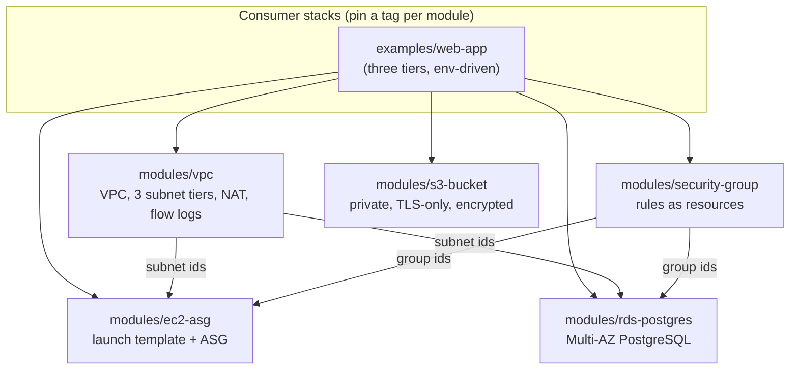
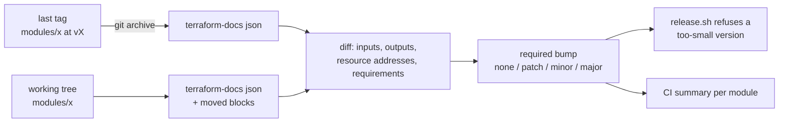

# terraform-module-library: architecture

## 1. Context

When every team writes its own VPC, security groups and databases in Terraform, the same mistakes repeat:
- SSH open to the internet;
- unencrypted volumes;
- buckets that can be made public;
- databases without backups or deletion protection.

A module library fixes this once: safe defaults, validations that reject risky inputs, and tests. It also creates a new problem. Consumers pin versions, so **an upgrade must never surprise them**: a removed variable breaks their plan, and a renamed resource destroys their database. This library treats each module's interface as a contract, and enforces it.

## 2. Module design principles

| Principle | How it shows up |
|---|---|
| Secure by default, opt out explicitly | IMDSv2 only, encrypted gp3, no public IPs; RDS Multi-AZ, encrypted, TLS forced, deletion protection, final snapshot; S3 public access blocked, ACLs off, non-TLS denied; the VPC's default security group has no rules |
| Reject risky input early | Variable validations, for example `0.0.0.0/0` only on the listed internet-facing ports, exactly one source per rule, valid bucket names, RDS storage at least 20 GiB, backup retention 1–35 days |
| One resource per rule or item, keyed by name | Security group rules are `for_each` over a map keyed by rule name, so adding a rule never forces others to be recreated (a list index would) |
| No secrets in state or code | The RDS password is generated and kept by RDS in Secrets Manager (`manage_master_user_password`); no password variable exists |
| Small, composable modules | Each module does one job and exposes the IDs the next needs (subnet IDs, group IDs, ARNs); the example composes them |
| Environment differences are inputs, not forks | One `env` variable in the example drives per-AZ NAT, Multi-AZ and deletion protection |

## 3. Modules

| Module | Key resources | Notable decisions |
|---|---|---|
| `vpc` | VPC, IGW, public, private and isolated database subnets, NAT gateways, route tables, flow logs | NAT mode `none`, `single` or `per_az` (cost vs AZ independence); one private route table per AZ, so per-AZ NAT is a pure input change; the database tier has no default route at all |
| `security-group` | Group plus individual ingress and egress rule resources | Rules as resources rather than inline blocks, so changes are additive and reviewable |
| `ec2-asg` | Launch template, Auto Scaling group, IAM instance profile (SSM) | Session Manager instead of SSH (no key pairs, no port 22); rolling instance refresh; CPU target tracking |
| `rds-postgres` | DB instance, subnet group, parameter group | Multi-AZ, IAM auth, `rds.force_ssl`, storage autoscaling, Performance Insights |
| `s3-bucket` | Bucket, ownership controls, public access block, versioning, encryption, lifecycle, logging, policy | Lifecycle expires noncurrent versions and aborts incomplete multipart uploads, which are the two silent cost leaks |

## 4. Versioning and the interface contract

Each module is tagged on its own (`vpc/v1.2.0`), so consumers upgrade one module at a time and a fix to `s3-bucket` doesn't force every VPC consumer to review an upgrade.

**What counts as breaking** (see the README's table) is enforced by `scripts/semver_check.py`:

| Change | Bump | Why |
|---|---|---|
| Input removed, newly required, type changed, default changed | MAJOR | Consumers' plans fail, or behaviour changes silently |
| Output removed | MAJOR | Consumers referencing it fail |
| Resource removed or renamed **without** a `moved` block | MAJOR | Terraform would destroy the old address and create the new one, which for a database means data loss |
| Resource renamed **with** a `moved` block | PATCH | State is moved; nothing is replaced |
| Minimum Terraform or provider version raised | MAJOR | Consumers on older versions can't init |
| New optional input, new output, new resource | MINOR | Additive |
| Descriptions, internals | PATCH | |

The check is itself tested twice:
- unit tests on synthetic interfaces;
- a CI self-test that makes one real edit of each kind to a copy of `s3-bucket` and checks the derived bump.

**What it can't see:** an argument change that forces replacement inside the same resource address, for example a changed `availability_zone`. That needs a plan against real state, which is the next step listed in the README (a sandbox apply from CI).

## 5. Testing pyramid

| Layer | Tool | Runs | What it catches |
|---|---|---|---|
| Format and validate | `terraform fmt`, `validate` | Every push | Syntax, types |
| Plan-level tests | `terraform test` with the AWS provider **mocked** (40 runs) | Every push, no AWS account | Wrong resource counts, wrong arguments, validations that don't reject bad input |
| Interface contract | `semver_check.py` + self-test | Every push; enforced at release | Breaking changes shipped as minor or patch |
| Lint | tflint, preset `all` + AWS ruleset | Every push | Deprecated arguments, invalid instance types, naming |
| Security | Checkov (116 checks pass; 7 skips, each with an inline reason) | Every push | Misconfigurations against CIS/AWS best practice |
| Docs | terraform-docs `--output-check` | Every push | READMEs out of sync with the code |
| Integration | LocalStack 4.4: real apply, read back through the AWS API, destroy | Every push (vpc, security-group, s3-bucket) | Behaviour the plan can't show: routes, policies actually applied |

**Not tested for real:** `ec2-asg` and `rds-postgres` (LocalStack's free edition has no Auto Scaling or RDS), and nothing has been applied to a real AWS account. The README says so.

## 6. Consumer guidance

- **Pin a tag per module.** Read the CHANGELOG section for the version, and run `terraform plan` before applying an upgrade. A MAJOR bump means "read the notes".
- **State:** remote state in S3 with DynamoDB locking (or S3 native locking on newer Terraform), one state per environment and stack. The library itself holds no state.
- **Credentials:** OIDC from CI to an AWS role, never access keys in CI secrets.

## 7. Failure modes

| Situation | What protects you |
|---|---|
| An upgrade would destroy a database | `semver_check` flags the renamed address as MAJOR. RDS `deletion_protection` and the final snapshot are the last line of defence. |
| Someone opens SSH to the world | The security-group validation rejects `0.0.0.0/0` on any port not listed as internet-facing |
| A bucket is made public later, by hand | Account-level and bucket-level public access blocks; the bucket policy denies non-TLS |
| A NAT gateway fails in one AZ | With `per_az`, only that AZ loses egress; with `single`, all private subnets do (documented as the cost trade-off) |

## 8. Next steps

- A short-lived apply in a sandbox AWS account from CI (OIDC role), so `ec2-asg` and `rds-postgres` are tested for real.
- A replacement check: plan the example at the last tag, apply it to LocalStack, upgrade to HEAD, and fail on any `replace` action.
- Policy as code (OPA/conftest) on the plan JSON for organisation rules Checkov doesn't cover: mandatory tags, allowed regions and instance families.
